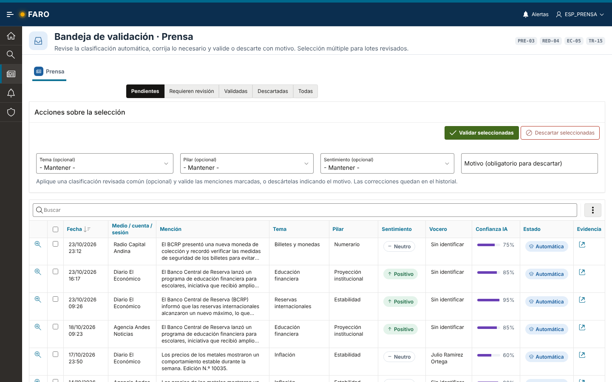
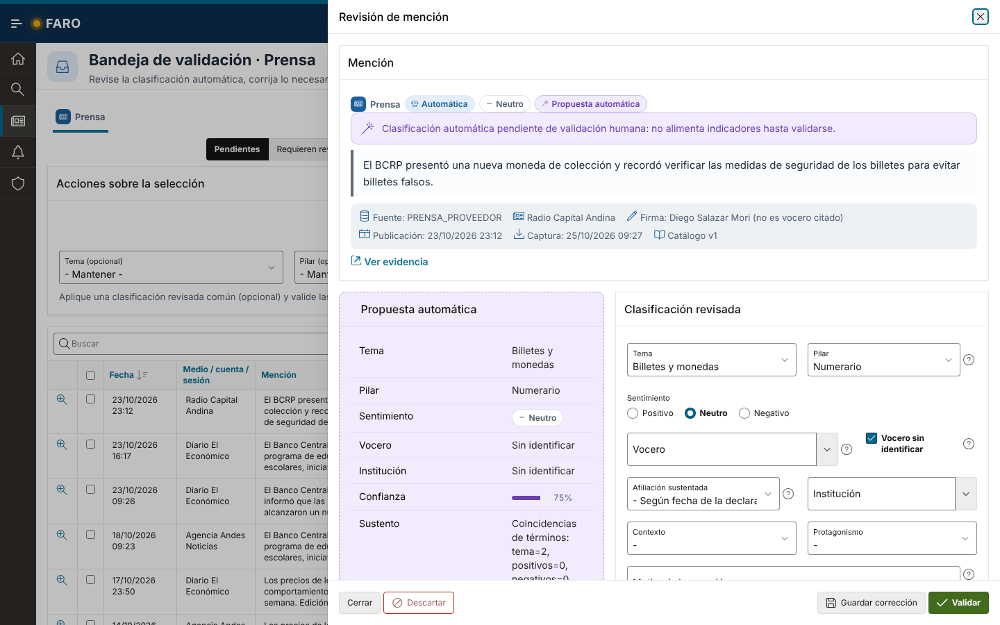
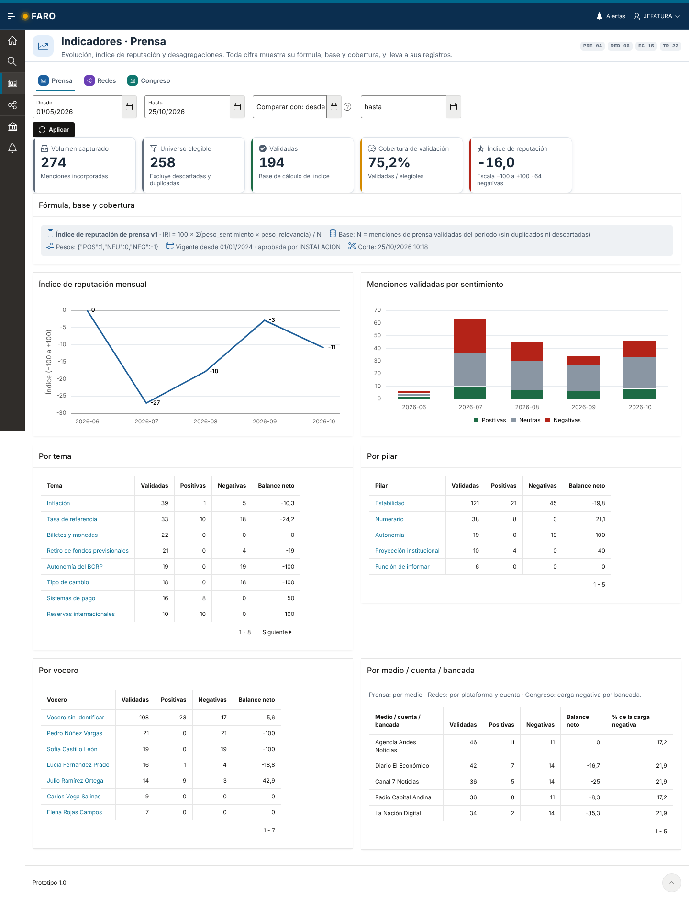
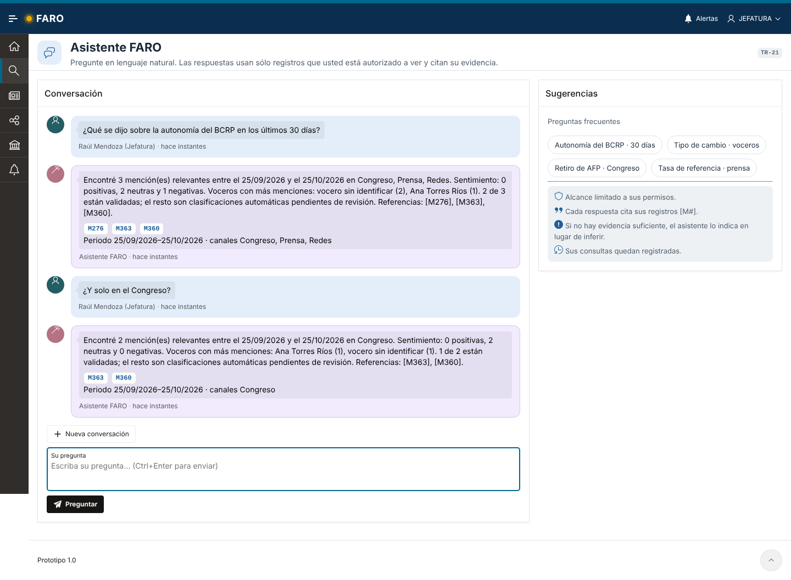
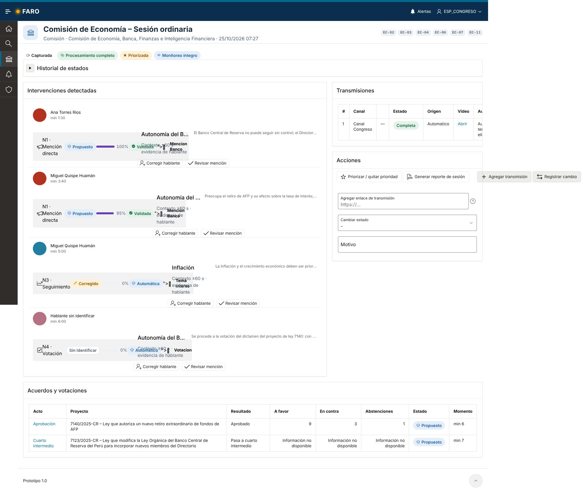
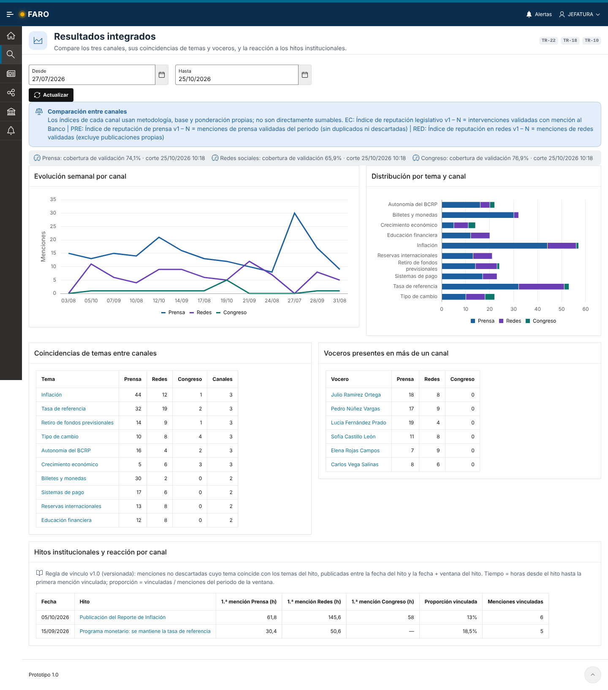

# Guía UX y sistema de diseño FARO

El portal se construye sobre **Universal Theme 42 (Redwood Light)** con una capa propia
(`apex/static/faro.css`, `faro.js`) y componentes HTML generados en PL/SQL por `faro_ui`, de modo que
el mismo lenguaje visual se repite en todas las páginas sin plantillas personalizadas que mantener.

## 1. Principios

1. **Lo que la IA propone siempre se distingue de lo que una persona validó.** Chip violeta
   «IA · 87 %» frente a chip verde «Validada»; la clasificación automática original queda visible en el
   panel de revisión aun después de corregida.
2. **Cada cifra explica de dónde sale.** Indicadores con fórmula, base, pesos, vigencia, corte y
   cobertura junto al número, y cada KPI enlaza a los registros que lo componen (drill-down).
3. **La evidencia está a un clic.** Fragmento citado (`faro-cita`), enlace al original y estado de
   disponibilidad; oculta para quien no tiene la capacidad `VER_EVIDENCIAS`.
4. **El alcance es visible.** El asistente y las exportaciones declaran canales y periodo autorizados;
   los periodos cerrados y los datos incompletos se señalan con banners.
5. **Operación rápida para especialistas.** Bandejas con acciones masivas, revisión en cajón lateral
   sin perder la lista y atajos de teclado.
6. **Trazabilidad funcional.** Cada página muestra en su cabecera los chips de las HU que atiende.

## 2. Tokens

| Token | Valor | Uso |
|---|---|---|
| `--faro-navy` | `#0b2e4f` | Cabecera, navegación |
| `--faro-azul` | `#1f5f99` | Acción primaria, enlaces |
| `--faro-ambar` | `#f2a900` | Marca (luz del faro), énfasis puntual |
| `--faro-ok` / `-bg` | `#1d6b45` / `#e3f3ea` | Validada, positivo, salud correcta |
| `--faro-info` / `-bg` | `#1c5f9e` / `#e3eefa` | Información, estados en curso |
| `--faro-warn` / `-bg` | `#8a5300` / `#fff1d6` | Pendiente, advertencias, cobertura parcial |
| `--faro-danger` / `-bg` | `#b42318` / `#fde8e6` | Negativo, crítico, fallo |
| `--faro-ia` / `-bg` | `#6a3fb5` / `#f1ebfd` | Contenido generado o propuesto por IA |
| `--faro-pre` · `--faro-red` · `--faro-ec` | azul · violeta · verde azulado | Identidad de canal (Prensa, Redes, Congreso) |

Los pares texto/fondo semánticos cumplen contraste **WCAG 2.1 AA** (≥ 4,5:1). El color nunca es la
única señal: todos los chips llevan icono y texto.

## 3. Componentes (`faro_ui`)

| Función | Resultado |
|---|---|
| `chip`, `estado`, `sentimiento`, `nivel`, `canal` | Etiquetas semánticas con icono |
| `origen_ia`, `confianza`, `confianza_pie` | Marca de propuesta automática y su confianza |
| `evidencia` | Enlace a la evidencia con estado de disponibilidad |
| `seguimiento`, `salud`, `fecha_rel` | Estado de alertas, salud de integraciones, fechas relativas |
| `kpi`, `kpis_inicio`, `kpis_canal` | Tarjetas KPI enlazadas a su detalle |
| `banner` | Mensajes contextuales (info, advertencia, IA, error) |

Todo el texto dinámico se escapa con `apex_escape` antes de componer HTML.

## 4. Patrones de página

| Patrón | Páginas | Notas |
|---|---|---|
| **Cabecera hero** | Todas | Icono, título, propósito en una línea, chips HU. |
| **Inicio por rol** | 1 | KPIs de pendientes, alertas abiertas y salud de integraciones según permisos. |
| **Bandeja + cajón** | 20 → 21 | Filtro por módulo, acciones masivas sobre la selección, revisión en *drawer* con atajos **Alt+V** validar, **Alt+G** guardar, **Alt+D** descartar. |
| **Explorador** | 9 | Informe interactivo con vistas guardadas y exportación XLSX con hoja de metadatos (filtros, corte, usuario). |
| **Búsqueda facetada** | 10, 49 | Facetas a la izquierda, resultados en tarjetas. |
| **Tablero de indicadores** | 13, 22 | Pestañas por canal, KPIs, bloque «Fórmula, base y cobertura», gráficos y desagregaciones enlazadas. |
| **Ficha / perfil** | 11, 12, 41, 45 | Contenido principal + panel lateral de contexto y acciones. |
| **Asistente conversacional** | 14 | Sugerencias de preguntas, **Ctrl+Enter** para enviar, alcance y referencias en cada respuesta. |
| **Catálogos** | 74–92 | Lista + modal de ficha, historial de versiones y propuestas de cambio. |

## 5. Capturas

| | |
|---|---|
|  Bandeja de validación |  Revisión en cajón |
|  Indicadores con fórmula visible |  Asistente con referencias |
|  Sesión del Congreso |  Resultados integrados |

## 6. Accesibilidad y localización

- Idioma `es`, formato de fecha `DD/MM/YYYY`, separador decimal coma; paquete de idioma español de APEX.
- Navegación lateral expandida por defecto con iconos y textos; foco visible en enlaces de KPI.
- Etiquetas en todos los campos, mensajes de validación asociados al campo, regiones con títulos.
- Gráficos con etiquetas de datos y leyenda textual; tablas como alternativa para cada gráfico.
